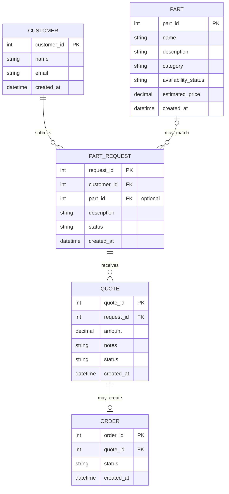
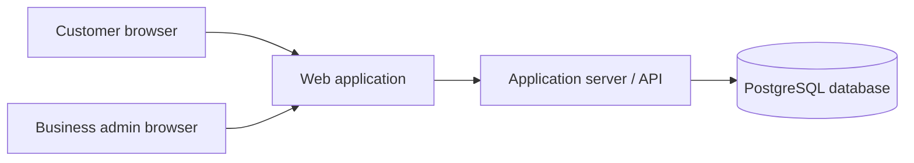

# Replacement Parts Ordering System — Initial Design

## Project purpose

My brother and I are exploring a replacement-parts business. He models replacement parts and arranges to have them 3D printed. I’m interested in building the website and software that support the customer and business workflow.

It can be difficult to find a replacement when an original part is unavailable or hard to identify. This project will start with a website that lets customers browse parts or request one, and lets the business track requests, quotes, and orders.

## Initial goals

- Create a catalog of replacement parts.
- Let customers submit requests for parts they cannot find.
- Let the business review requests, prepare quotes, and track order status.
- Store and retrieve the project’s data in a relational database.
- Use AI as a development aid for planning, coding, and improving the design.

## First version scope

The first version will focus on the catalog and request-to-order workflow.

**Included:**

- View a list of available parts and their descriptions.
- Submit a request for a known or unknown part.
- Review requests in a simple admin view.
- Record a quote and update request or order status.

**Not included in the first version:**

- Online payments
- Automated shipping
- Automated manufacturing or printer control
- Automatic creation of CAD models

These features could be considered later if time allows.

## Initial ERD

A request can optionally point to a catalog part. If the customer is asking about something that is not in the catalog yet, the request can still be saved with a description. A request may receive more than one quote while it is being reviewed. An accepted quote may lead to one order.

## Rough system design

### Technologies under consideration

- **Website:** React
- **Application server/API:** Node.js with Express
- **Database:** PostgreSQL
- **Source control:** GitHub
- **Hosting:** Choose a simple hosting option after the local version works.

### Security boundaries

- Customers use the public website to view parts and submit requests.
- Business administration features require an authenticated admin account.
- The application server checks permissions before changing business data.
- The database is accessed by the application server, not directly by a customer’s browser.
- The first version will store only the customer information needed to respond to requests. It will not store payment-card information.

### Scaling and cost considerations

The first version is intended for a small business and a modest number of customers. I’ll start with a simple application and database setup, then consider hosting cost, backups, and performance if usage grows. The system design interview will help me refine these choices.

## Feedback and changes

I’ll record useful feedback from classmates, the instructor, and TAs here, then update the design as the project develops.

- Initial feedback: _Add feedback after the pitch._
- Design changes: _Record changes and why they were made._
